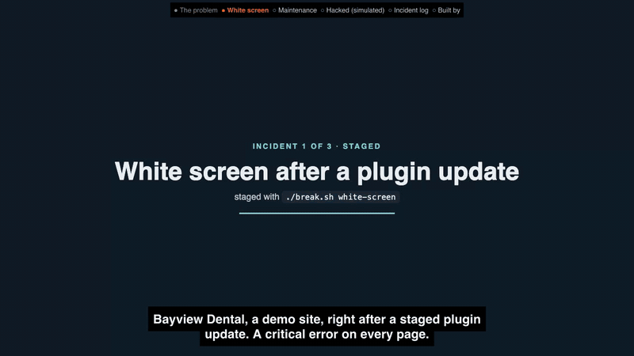

# WordPress site rescue: three broken sites, three playbooks

A healthy WordPress site for **Bayview Dental**, a fictional clinic in Davao City, broken three realistic ways and fixed by scripted, timed playbooks. Each playbook finds the cause from evidence (HTTP status, `debug.log`, WP-CLI, wordpress.org checksums, the database), fixes only that, and verifies the site, booking form included. Everything runs locally in Docker and is driven only by WP-CLI and the shell.

**What this proves:** three scripted playbooks find what broke a WordPress site from evidence alone (HTTP status, `debug.log`, WP-CLI, wordpress.org checksums, the database), fix only that, and prove the site and its booking form are back. `rescue.sh` never reads what `break.sh` did.

[](demo/p5-demo.mp4)

14-second preview at 5x speed. Click it for the full 85-second narrated demo (`demo/p5-demo.mp4`).

**Live case study:** https://mckenneth.vercel.app/case-studies/wp-site-rescue/

**`./check.sh`, run again on 16 Oct 2026** (each incident: restore → break → confirm broken → rescue → confirm healthy; real output, shortened):

```text
[check] ok   (white-screen): broken: home 500, critical error page
[check] ok   (white-screen): home 200, all sections + booking form present
[shots] ok   white-screen-healthy vs baseline: 0.000% of 1280×5006 px differ (≤ 0.5%)
[check] ok   (maintenance-stuck): broken: home 503, maintenance message
[check] ok   (maintenance-stuck): no .maintenance, plugin checksums pass
[shots] ok   maintenance-stuck-healthy vs baseline: 0.000% of 1280×5006 px differ (≤ 0.5%)
[check] ok   (hacked): broken: spam links on home, extra admin, PHP in uploads
[check] ok   (hacked): admins = allowlist, no spam on any page, no PHP in uploads, checksums pass, uploads PHP denied
[check] ok   (hacked): salts shuffled (AUTH_KEY changed), admin password hash changed, admin sessions destroyed
[shots] ok   hacked-healthy vs baseline: 0.000% of 1280×5006 px differ (≤ 0.5%)
[check] PASS — 3 incidents broken and rescued in 1061s; site left healthy
```

This run took longer than the times in the table below (62 s, 82 s and 227 s to fix) because a Lighthouse check was running on the same machine at the same time. The check tests the result, not the speed.

**Caveat:** Bayview Dental is a fictional clinic and this is a demo site, not client work. `break.sh` stages the incidents. The "hacked" one is an inert simulation, and nothing real was attacked.

## Results

From the committed run logs (`logs/*.json`, rendered as `incidents.html`):

| Incident | What it is | Steps | Fixed in | Checks passed |
|---|---|---:|---:|---:|
| `white-screen` | White screen after a plugin update | 6 | 7.0 s | 4 |
| `maintenance-stuck` | Stuck in maintenance mode | 6 | 17.5 s | 4 |
| `hacked` | Hacked site (inert simulation) | 13 | 23.6 s | 8 |

"Fixed in" is script time from the start of `rescue.sh` to the last check. It varies per run with host load (each WP-CLI call boots WordPress with Elementor); the filmed run in `demo/p5-demo.mp4` shows its own times (7.1 s, 18.0 s, 37.7 s).

## Run it

```bash
assets/fetch-photos.sh   # 10 Wikimedia Commons photos → assets/photos (gitignored), see assets/CREDITS.md
./seed.sh                # builds the healthy site on http://localhost:8092 (admin/admin) and snapshots it
./break.sh white-screen  # or maintenance-stuck | hacked
./rescue.sh white-screen # diagnose → fix → verify, prints a timed log, writes logs/white-screen.json
./restore.sh             # back to the healthy snapshot, byte for byte
./check.sh               # all three: restore → break → assert broken → rescue → assert healthy (about 2–3.5 minutes)
node render-incidents.mjs  # incidents.html from logs/*.json + img/*.jpg
```

Requirements: Docker, Node 22, ImageMagick 7 (`magick`), Playwright (`npm i playwright` or set `PLAYWRIGHT_PATH`), perl (for the step clock). Stack: compose project `va-p5`, MariaDB 11, `wordpress:php8.3-apache`, `wordpress:cli-php8.3`. Pinned: Astra 4.14.0, Elementor 4.3.4, Contact Form 7 6.2.1, plus the clinic's own `bayview-booking` plugin (`php/bayview-booking/`).

## The incidents

| Incident | What `break.sh` does | How `rescue.sh` finds and fixes it |
|---|---|---|
| `white-screen` | "Updates" `bayview-booking` 1.4.2 → 1.5.0, keeping the old copy in `wp-content/upgrade-backups/`. 1.5.0 calls a function it never shipped on `init`. | HTTP 500 → last fatal in `debug.log` → plugin from the stack-trace path → `wp plugin deactivate --skip-plugins` → roll back from the backup → re-activate → verify. |
| `maintenance-stuck` | Leaves WordPress's `.maintenance` in the web root and two Contact Form 7 files half-written. | HTTP 503 + message → remove `.maintenance` (site now 500) → `debug.log` → `wp plugin verify-checksums --all` names the plugin and files → `wp plugin install <slug> --version=<installed> --force` → verify. |
| `hacked` | **Simulation.** Adds admin `wp_support_admin`, spam links in two posts (hidden off-screen) and in the footer option, and an inert `eval(base64_decode(...))` file in `uploads/2026/10/` that only prints a fixed string. | Outbound links on every page vs allowed hosts → admins vs `admins.allow` → core/plugin checksums + custom plugin vs repo copy → PHP in uploads + signatures → quarantine to `./quarantine/` → delete rogue user (reassign) → `wp db search` the exact injected markup → `wp search-replace` it out → reset admin passwords, destroy sessions, shuffle salts → `.htaccess` denies PHP in uploads (probe answers 403) → verify. |

Nothing in `rescue.sh` knows what `break.sh` did: plugin names, files, users and spam come from HTTP responses, `debug.log`, WP-CLI and the database at run time.

## Check thresholds

`check.sh` fails when, after a rescue: home is not HTTP 200; any section heading, the booking box or the form is missing; the full-page Playwright screenshot differs from the healthy baseline by more than **0.5 %** of pixels (`magick compare -metric AE -fuzz 10%`; real runs: 0.000 %, a missing booking box changes the page height and fails outright); or an incident-specific check fails (plugin version, `.maintenance`, checksums, admins = allowlist, spam on any page, PHP in uploads, uploads `.htaccess`).

## The hacked incident is an inert simulation

`break.sh hacked` plants what a compromise usually looks like, on your local demo site only: an extra administrator, spam links to `example.com` / `example.net`, and a "backdoor" file in `wp-content/uploads/2026/10/`. That file's content lives inside `break.sh`. Line 1 labels it `SIMULATION — inert`; line 2 is `eval(base64_decode('…'))` whose payload decodes to `echo "SIMULATION: inert demo file";`. It reads no request input (no `$_GET`, `$_POST`, `$_REQUEST`, `$_COOKIE`), so it cannot run anything you send it. It exists only so the scanner has a real malware-style signature to find.

## Honest notes

- Bayview Dental is a fictional clinic and this is a demo site, not a client's. The incidents are staged by `break.sh`; nothing real was attacked.
- `rescue.sh` never uses the names `break.sh` used; the plugin, files, user and spam snippets are read from the site at run time. The spam extraction recognises two wrappers (a hidden `<div>` of links, or a bare link with its `·` separator); other injection styles would need a new pattern (marked `ponytail:` in `rescue.sh`).
- `maintenance-stuck` truncates files rather than deleting them, because `wp plugin verify-checksums` only reports files that are present.
- The custom `bayview-booking` plugin has no wordpress.org checksums, so the hacked playbook diffs it against its repo copy in `php/`.
- `verify-checksums` and the Contact Form 7 reinstall need internet access to wordpress.org.
- On a real site a rescue starts with a full backup and works on a staging copy where it can; these scripts skip that because `restore.sh` rebuilds the demo from its snapshot.
- `demo/` holds the scripts that filmed the video (Playwright capture, cloned-voice narration, ffmpeg assembly) and `p5-demo.mp4`. Re-filming needs Playwright (`npm i -D playwright` or `PLAYWRIGHT_PATH`) and your own voice clip via `REF=/path/to/clip.wav` (never committed).
- `snapshot/` (healthy database + docroot, ~210 MB), `shots/` and `quarantine/` are rebuilt by the scripts and not committed.

Built by McKeen Asma with Claude Code. MIT licence.
